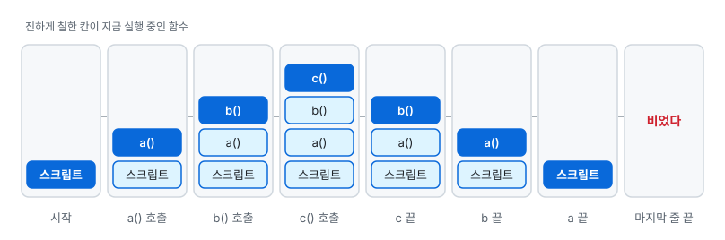
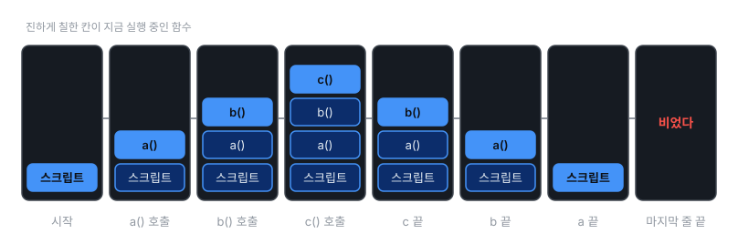
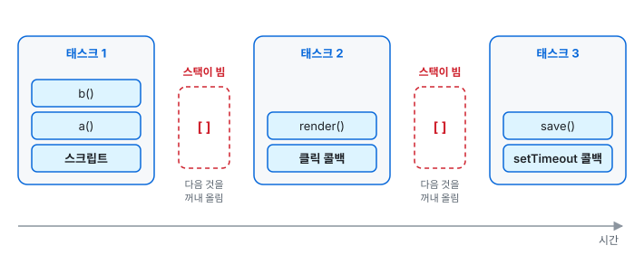
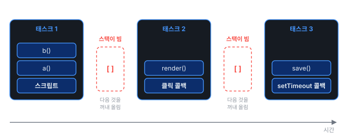
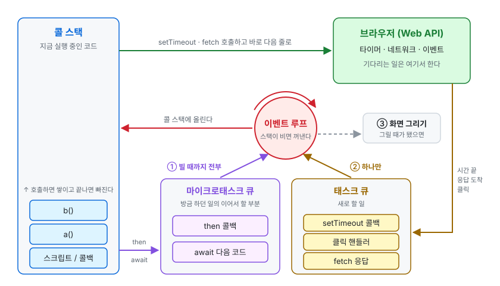
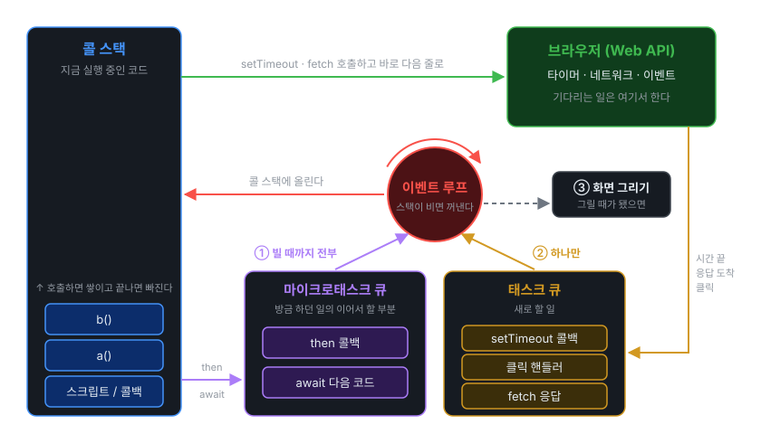

자바스크립트는 싱글 스레드이고 이벤트 루프로 비동기를 처리한다는 말은 여러 번 들었다. 그런데 매일 `async/await`를 쓰면서도 `setTimeout`과 `Promise`가 어떤 순서로 실행되는지 바로 설명하라고 하면 막힌다. 이벤트 루프가 어떻게 돌아가는지 다시 한번 정리해보려고 한다.

## 콜 스택

자바스크립트는 한 번에 하나의 코드만 실행한다. 지금 실행 중인 함수는 **콜 스택**에 쌓인다. 함수를 호출하면 스택 위에 올라가고, 함수가 끝나면 빠진다.

```js
function c() {
  console.log('c');
}

function b() {
  c();
}

function a() {
  b();
}

a();
console.log('끝');
```

{: .light }
{: .dark }

스크립트 파일 전체가 스택 맨 아래에 올라간다. 그 위로 함수가 쌓였다 빠지기를 반복하다가, 마지막 줄까지 끝나면 스택이 빈다.

스택이 빈 뒤에 실행되는 코드도 같다. 클릭 핸들러나 `setTimeout` 콜백이 실행될 때는 그 콜백이 스택 맨 아래에 올라가고, 콜백이 끝나면 다시 빈다.

이렇게 빈 스택에서 시작해 다시 빌 때까지 한 번에 실행되는 단위를 **태스크**라고 부른다. 스크립트 실행, 클릭 핸들러 실행, `setTimeout` 콜백 실행이 각각 태스크 하나다. 자바스크립트 실행은 태스크가 하나씩 이어지는 반복이다.

{: .light }
{: .dark }

태스크 하나가 끝나야 다음 태스크가 시작된다. 태스크 하나가 오래 걸리면 그동안 다른 코드는 실행되지 않는다.

```js
function wait(ms) {
  const start = Date.now();
  while (Date.now() - start < ms) {}
}

button.addEventListener('click', () => {
  wait(3000);
});
```

버튼을 누르면 3초 동안 페이지가 멈춘다. 스크롤도, 다른 클릭도, 화면 갱신도 안 된다. `wait`가 3초 동안 끝나지 않아서 콜 스택이 비지 않기 때문이다. 브라우저에서 자바스크립트는 **메인 스레드** 하나에서 실행되고, 화면을 그리는 작업도 같은 메인 스레드에서 한다.

## 비동기 작업

그런데 `fetch`로 응답을 기다리는 동안에는 페이지가 멈추지 않는다.

```js
console.log('A');
fetch('/api').then(() => console.log('응답 옴'));
console.log('B');

// A → B → 응답 옴
```

`setTimeout`, `fetch`, 이벤트 리스너는 자바스크립트 언어에 들어 있는 기능이 아니다. 자바스크립트 코드를 실행하는 건 **엔진**이다. 크롬과 Node.js는 V8, 사파리는 JavaScriptCore, 파이어폭스는 SpiderMonkey를 쓴다. 엔진은 콜 스택과 메모리를 관리하면서 코드를 실행할 뿐, 타이머나 네트워크 기능은 갖고 있지 않다.

이런 기능은 엔진을 포함한 **실행 환경**이 제공한다. 브라우저는 `setTimeout`, `fetch`, DOM 이벤트를 제공하고, Node.js는 `setTimeout`을 따로 구현해 제공하면서 파일 시스템 같은 서버용 기능도 더한다. 같은 V8을 쓰는데 크롬에는 `document`가 있고 Node.js에는 `fs`가 있는 이유다. 뒤에서 볼 이벤트 루프도 엔진이 아니라 실행 환경에 있다.

이 기능들은 메인 스레드에서 결과를 기다리지 않는다. `fetch`를 호출하면 요청은 브라우저의 네트워크 담당 프로세스로 넘어가고, 메인 스레드는 바로 다음 줄을 실행한다. `setTimeout`은 타이머를 등록하고 바로 반환한다. 클릭은 브라우저가 OS에서 입력을 받아 페이지로 전달한다.

`then`이나 `setTimeout`에 넘긴 함수는 작업이 끝났을 때 실행할 콜백으로 등록된다. 응답이 오거나 시간이 되면 그 콜백이 실행될 준비가 된다.

같은 3초여도 `while`은 메인 스레드에서 직접 실행되기 때문에 모든 게 멈추고, `fetch`나 `setTimeout`은 메인 스레드 밖에서 기다리기 때문에 다른 코드가 계속 실행된다.

## 이벤트 루프

브라우저는 응답이 오거나 시간이 되면 등록된 콜백을 **큐**에 넣는다. 아직 실행하지는 않는다.

큐에 있는 콜백을 콜 스택에 올리는 게 **이벤트 루프**다. 이벤트 루프는 콜 스택이 비었는지 확인하고, 비어 있으면 큐 맨 앞의 콜백을 꺼내 스택에 올린다.

```js
console.log('A');
setTimeout(() => console.log('B'), 0);
console.log('C');

// A → C → B
```

1. `A`를 찍는다.
2. `setTimeout`이 타이머를 등록한다. 0ms라서 콜백이 바로 큐에 들어간다.
3. `C`를 찍는다.
4. 스크립트가 끝나서 콜 스택이 빈다.
5. 이벤트 루프가 큐에서 콜백을 꺼내 스택에 올린다. `B`를 찍는다.

0ms를 줘도 `C`보다 늦은 건, 큐에 있는 콜백은 콜 스택이 빈 뒤에야 실행되기 때문이다.

같은 이유로 `setTimeout(fn, 100)`은 100ms 뒤에 실행한다는 뜻이 아니라, 100ms 뒤에 큐에 넣는다는 뜻이다. 그때 다른 코드가 실행 중이면 끝날 때까지 실행되지 않는다. 늦게 실행될 수는 있어도 일찍 실행되지는 않는다. 시간이 정확하지 않고 화면을 그리는 시점과도 맞지 않아서, 애니메이션에는 화면을 그리기 직전에 실행되는 `requestAnimationFrame`을 쓴다.

## Run-to-completion

이벤트 루프는 콜 스택이 **비었을 때만** 큐에서 콜백을 꺼낸다. 함수가 실행되는 도중에 응답이 오거나 클릭이 들어와도, 실행 중인 함수를 멈추고 콜백을 먼저 실행하지 않는다. 한번 실행을 시작한 코드는 끝날 때까지 중간에 다른 코드가 실행되지 않는다. 이걸 **run-to-completion**이라고 한다.

큐 없이 콜백이 도착하는 즉시 실행된다면, 코드 어느 줄에서든 다른 콜백이 실행될 수 있다.

```js
let count = 0;

function increase() {
  const current = count;
  // 이 시점에 클릭 콜백이 실행되어 count를 100으로 바꿨다면
  count = current + 1; // 100은 사라지고 1이 된다
}
```

이러면 변수가 언제 바뀔지 알 수 없어서, 싱글 스레드인데도 멀티 스레드처럼 락을 걸어야 한다. 콜백을 큐에 넣고 스택이 빈 뒤에 실행하면, 지금 실행 중인 코드는 끝까지 다른 코드의 영향을 받지 않는다. 콜백을 하나씩 실행하기 때문에, 하나가 끝나고 다음 것을 꺼내기 전에 브라우저가 화면을 그릴 수도 있다.

대신 앞에서 본 `wait(3000)`처럼 실행 중인 코드가 오래 걸리면, 큐에 있는 콜백도, 클릭 처리도, 화면 그리기도 전부 그만큼 늦어진다.

## 태스크와 마이크로태스크

큐는 두 종류가 있다.

- **태스크 큐**: 앞에서 본 태스크가 들어간다. 클릭, `setTimeout` 콜백, 네트워크 응답 도착 같은 일이다.
- **마이크로태스크 큐**: 지금 실행 중인 작업에 이어서 실행할 코드가 들어간다. `Promise.then` 콜백과 `await` 다음 코드다.

`fetch(...).then(...)`은 두 큐를 모두 거친다. 응답이 도착했다는 처리는 태스크로 실행되고, 그 안에서 Promise가 resolve되면 `then` 콜백이 마이크로태스크 큐에 들어간다.

이벤트 루프는 스택이 비면 마이크로태스크 큐를 먼저 확인한다. 마이크로태스크는 다음 태스크보다 먼저 실행된다.

```js
console.log('A');
setTimeout(() => console.log('B'), 0);          // 태스크 큐
Promise.resolve().then(() => console.log('C')); // 마이크로태스크 큐
console.log('D');

// A → D → C → B
```

스크립트가 끝나고 스택이 비면, 마이크로태스크 큐의 `C`가 먼저 실행되고 태스크 큐의 `B`는 그다음이다.

두 큐는 꺼내는 방식도 다르다.

- 태스크는 **하나** 꺼내 실행한 뒤 마이크로태스크 큐를 비우고, 화면을 그릴 시점이면 화면을 그린다. 그다음에 다음 태스크를 꺼낸다.
- 마이크로태스크는 큐가 **빌 때까지** 전부 실행한다. 실행 도중에 새로 추가된 것도 이어서 실행한다.

그래서 마이크로태스크가 계속 추가되면 페이지가 멈춘다.

```js
function loop() {
  Promise.resolve().then(loop);
}
loop(); // 페이지가 멈춘다
```

마이크로태스크 큐가 비지 않아서 화면 그리기 단계로 넘어가지 못한다. 같은 코드를 `setTimeout(loop)`로 바꾸면 멈추지 않는다. 태스크는 하나씩 실행되고, 태스크와 태스크 사이에 화면을 그릴 수 있기 때문이다.

지금까지의 구조를 그림으로 정리하면 이렇다.

{: .light }
{: .dark }

## async/await

`await`는 내부적으로 `then`과 같다. `await`한 대상이 끝나면, 함수의 나머지 부분이 마이크로태스크 큐에 들어간다. `null`처럼 이미 끝난 값이면 바로 들어간다.

```js
async function run() {
  console.log('a');
  await null;
  console.log('b'); // await 다음 코드 → 마이크로태스크
}

run();
console.log('c');

// a → c → b
```

`run()`은 `await`를 만나기 전까지 바로 실행돼서 `a`를 찍는다. `await`에서 함수 실행이 멈추고, 나머지 부분은 마이크로태스크 큐에 들어간다. 그리고 호출한 쪽으로 돌아가 `c`를 찍는다. 스택이 비면 `b`를 찍는다.

`await`를 만나면 그 함수는 스택에서 빠진다. 나머지 부분은 마이크로태스크 큐에 있다가, 순서가 되면 다시 스택에 올라와 이어서 실행된다. 함수가 스택에 남아서 기다리는 게 아니라서 그동안 다른 코드가 계속 실행된다.

## 긴 작업

앞에서 본 `wait(3000)`처럼 태스크 하나가 오래 걸리면 그동안 클릭을 처리하지 못하고 화면도 그리지 못한다. 50ms가 넘는 태스크를 **긴 작업**(long task)이라고 부른다.

큰 작업은 여러 태스크로 나눠서 중간중간 스택을 비운다.

```js
async function processAll(items) {
  for (let i = 0; i < items.length; i++) {
    process(items[i]);

    if (i % 100 === 0) {
      await new Promise((resolve) => setTimeout(resolve)); // 나머지를 다음 태스크로
    }
  }
}
```

100개마다 `setTimeout`으로 나머지 작업을 다음 태스크로 넘기면, 태스크 사이에 브라우저가 클릭을 처리하고 화면을 그린다. 여기서 `await Promise.resolve()`를 쓰면 안 된다. 앞에서 본 무한 `then` 루프처럼, 마이크로태스크는 다음 태스크로 넘어가기 전에 전부 실행되기 때문에 화면을 그릴 수 없다. 지원하는 브라우저에서는 이 용도로 만들어진 `scheduler.yield()`를 쓸 수도 있다.

계산 자체가 무거우면 나누는 대신 **Web Worker**로 메인 스레드가 아닌 별도 스레드에서 실행한다.

React도 같은 문제를 겪는다. 큰 화면을 렌더하면 그 자체가 긴 작업이 된다.
